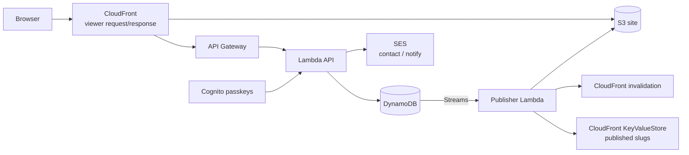

# gagnechris.com

Personal site and headless CMS for [gagnechris.com](https://gagnechris.com): statically prerendered public pages, an admin UI with Cognito passkeys, draft → publish for posts / projects / home / resume, and a private Notebook (daily notes, pages, tasks, search, and export).

> GitHub profile intro lives in the root [`README.md`](../README.md) (this special `username/username` repo). GitHub prefers `.github/README.md` over the root for **both** the profile and the repo page, so project docs stay here under `docs/` instead.

## Architecture at a glance



Public HTML (home, resume, blog posts), `posts.json`, `sitemap.xml`, `rss.xml`, and `resume.pdf` are written by the **publisher** on publish — not by the Vite web build.

## Quickstart (local admin)

Requires Node.js 22.12+ (see `.nvmrc`) and Docker (DynamoDB Local).

```bash
nvm use
npm ci
npm run local:dev
```

Open the CMS at [http://localhost:5174](http://localhost:5174) and Notebook at [http://localhost:5175](http://localhost:5175); the public site is on [http://localhost:5173](http://localhost:5173). Local mode uses a fake signed-in session (`VITE_AUTH_MODE=local`) and never touches production AWS.

Useful commands:

```bash
npm test
npm run typecheck
npm run lint
npm run e2e:local
npm run e2e:browser
```

`npm run dev` starts Vite only (API proxied to local by default). To hit **production** APIs from Vite, use `npm run dev:prod-api` — it prints a PRODUCTION banner; prefer `local:dev` for day-to-day work.

## Repo layout

```
apps/web/              React/Vite public site, admin and Notebook apps
apps/mobile/           Expo iOS app (Notebook and Admin); own lockfile, not a root workspace
services/api/          Go API (cmd/api, internal/), the restore-test validator, the black-box HTTP suite (test/)
services/publisher/    DynamoDB Streams → prerender HTML/PDF/RSS/sitemap
packages/shared/       Domain schemas/types; `/render`, `/openapi` and other subpaths
packages/data/         DynamoDB keys, item schemas and builders for the publisher, ops, infra and tests
packages/api-client/   OpenAPI types and `createApiClient`
packages/app-core/     UI-free hooks shared by the web apps and the iOS app
packages/public-ui/    Public page components: publisher SSR, hydrated by the site
packages/tokens/       Design tokens (TS → CSS variables)
packages/ops/          Restore copy-back and row migrations
infra/                 AWS CDK (CloudFront, S3, API, Cognito, SES, …)
scripts/               Local stack, deploy-web, branch protection
docs/                  Architecture, development, data model, E2E
e2e/                   Playwright browser tests
```

## Workflow

- One Linear ticket → one branch → one PR into `main` (prefer the issue `gitBranchName`)
- CI on PRs: lint, typecheck (all workspaces), tests, build, Go lint and test, CDK diff; required checks are **Lint, test, and build**, **Local E2E smoke**, **API integration (DynamoDB Local)** and **Mobile typecheck, lint, test, bundle**
- Merge to `main` deploys via OIDC only after CI succeeds (CDK + web sync + CloudFront invalidation; path-filtered against last deployed SHA in SSM; the deploy job refuses rollbacks, SSM read errors and multi-GSI changes — see `infra/RUNBOOK.md`)
- Infrastructure only through CDK — no console edits to production

## Docs index

| Doc                                                                                      | What it’s for                                                                                                                  |
| ---------------------------------------------------------------------------------------- | ------------------------------------------------------------------------------------------------------------------------------ |
| [architecture.md](./architecture.md)                                                     | Request flow, draft/published model, publisher, 404s, auth                                                                     |
| [development.md](./development.md)                                                       | Setup, local stack, tests, env vars, troubleshooting                                                                           |
| [data-model.md](./data-model.md)                                                         | Single-table DynamoDB keys and entities                                                                                        |
| [adding-an-entity.md](./adding-an-entity.md)                                             | Steps and files for a new Notebook or publishable entity                                                                       |
| [local-e2e.md](./local-e2e.md)                                                           | Local DynamoDB + API + publisher smoke / day-to-day admin                                                                      |
| [mobile.md](./mobile.md)                                                                 | Expo app: install layout, auth setup, CI bundle checks                                                                         |
| [agent-rules/](./agent-rules/README.md)                                                  | Rules for the AI agents that build this repo: engineer brief, definition of done, git workflow, AWS changes, comments and docs |
| [adr/0001-passkey-rp-id.md](./adr/0001-passkey-rp-id.md)                                 | Passkey RP ID stays `auth.gagnechris.com`                                                                                      |
| [adr/0002-admin-notebook-subdomains.md](./adr/0002-admin-notebook-subdomains.md)         | `admin.` / `notebook.` hosts, clients, groups, cutover                                                                         |
| [adr/0003-one-renderer-for-public-pages.md](./adr/0003-one-renderer-for-public-pages.md) | Public pages: one React renderer, SSR in the publisher, hydrated                                                               |
| [adr/0004-ios-app.md](./adr/0004-ios-app.md)                                             | iOS stack, v1 offline policy, cache, tokens, auth callback, outbox rules                                                       |
| [design/bears-2.0/](./design/bears-2.0/README.md)                                        | Don't Feed the Bears 2.0 artboards, tuning, prototype code                                                                     |
| [design/public-redesign/](./design/public-redesign/README.md)                            | Public site redesign artboards (Editorial)                                                                                     |
| [../infra/RUNBOOK.md](../infra/RUNBOOK.md)                                               | Production AWS operations                                                                                                      |

## Contributions

Issues welcome. Not accepting pull requests (this is a personal site; fork PRs cannot run the AWS deploy workflows).

## License

- **Code:** [MIT](../LICENSE) — `Copyright (c) 2026 Chris Gagne`
- **Content:** [CONTENT-LICENSE](../CONTENT-LICENSE) — blog posts, resume, bio, photos, and artwork (including Don’t Feed the Bears) are © Chris Gagne, all rights reserved
- **Third-party:** Newsreader and Inter fonts for resume PDFs and the self-hosted web fonts (Newsreader, Inter) remain under the SIL Open Font License — see [`services/publisher/assets/fonts/`](../services/publisher/assets/fonts/) and [`apps/web/public/fonts/`](../apps/web/public/fonts/)
